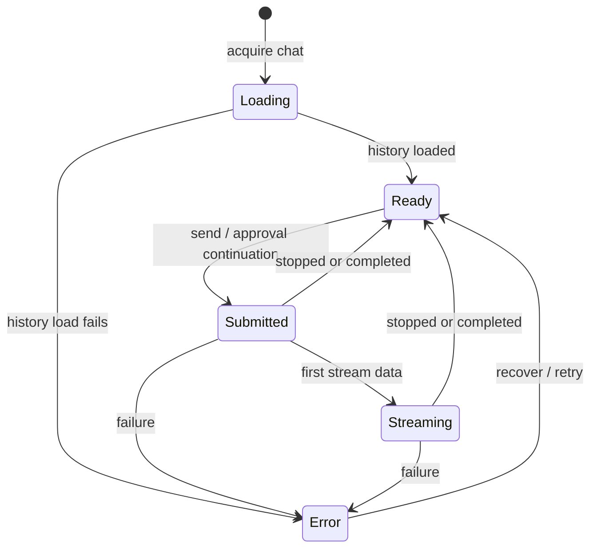

# Per-chat streaming lifecycle

## Goal and scope

A user can start a model or ACP agent response, switch to another chat, and return to the original chat to see its current progress and controls. Several chats may stream concurrently. Switching chats or leaving the chat page does not stop a response. This design applies to both Electron and the local HTTP runtime.

The initial scope is the lifetime of one renderer session. Reloading or closing the window, losing the HTTP connection, or terminating the backend can interrupt a response. Reconnecting to a stream after those events is a separate backend feature; the UI must not claim that such a response is still running without evidence. The HTTP reconnect endpoint currently returns 204 and Electron's listener registration does not replay missed chunks.

## User experience

- A chat with a submitted or streaming response shows a labeled activity indicator in history, including when another chat is selected. The active conversation shows its partial response and Stop control.
- Switching conversations changes the visible conversation only. Returning shows the same live messages, status, pending tool approval, and Stop control. Other chats remain usable and can start their own responses.
- Stop affects only the selected chat's current response. On completion the indicator clears and the final response remains visible. On failure, the affected chat shows an error and retains whatever partial output is available in that session. A pending approval is displayed in its originating chat and does not block other chats.
- Deleting a running chat first cancels its response, waits for termination, then deletes it. If cancellation or deletion fails, retain the chat and surface the error; never recreate a deleted chat from a late completion callback.
- A reload or lost connection shows persisted history, not a fabricated running indicator. Interrupted work should be communicated when it can be reliably detected; durable interruption detection is outside this initial scope.

## Ownership and state

Create a renderer-session chat registry owned by a provider alongside the existing app store/SWR provider, above route pages. It owns one externally managed AI SDK `Chat` instance per chat ID and its transport. `useChat({ chat })` subscribes the visible conversation to the selected instance; unmounting a page or switching selection only unsubscribes. The registry continues consuming streams without a mounted conversation component. Do not create mutable registry entries during React render. Create or acquire entries through an explicit provider/controller operation and expose stable snapshots via subscriptions; avoid module globals so renderer trees and tests stay isolated.

Each entry tracks the SDK status and messages, initial-history hydration, and a generation identity. The UI derives activity from `submitted` and `streaming`; `ready` and `error` are idle terminal states. An approval request is represented by its message parts, not inferred from stream status. Start, completion, failure, and stop must be attributed to the entry and generation that produced them, never to the currently selected chat.

Only one generation may be active per chat. Reject duplicate sends while submitted or streaming, including calls that race before the UI updates. Different chats may run concurrently. Use a generation ID for every request and ignore late events or cleanup from an older generation. Disable sending until initial history has loaded; hydrate exactly once before the first send and never overwrite live messages with a delayed query or cache revalidation. An explicit reload of an idle entry may reconcile persisted data; it must not replace active state.

The registry keeps active entries even when history is filtered or the route changes. Evict idle entries only when safe, after their final metadata updates and history invalidation complete. Registry disposal at renderer teardown cleans up subscriptions and explicitly stops active streams; do not claim survival across teardown. Stop and delete must be idempotent.

## Transport and backend contracts

Use existing `createChatTransport()` for each SDK chat. Electron sends chunks on a per-chat channel and currently stores abort controllers in `StreamingChatController`; HTTP ties its abort controller to request close. Maintaining the original consumer across UI navigation keeps those connections alive, but backend disconnects remain terminal. No reconnect API is assumed.

Enforce the one-generation-per-chat rule at the backend as well as the renderer. Electron must not overwrite an existing controller for the same chat/channel, and cleanup must remove only its own generation. HTTP needs equivalent tracking in a shared runtime service, rather than a controller-local map that differs across runtimes. Validate input at IPC and HTTP boundaries, identify requests by validated chat and generation IDs, and reject overlapping requests with a clear error. Explicit cancellation must target the matching generation. Do not expose arbitrary channel names as authority to cancel another request.

The current backend saves the user message at stream creation and saves assistant text and reasoning on successful completion; it does not persist the full live UI message parts. Consequently partial responses, tool state, and approval state survive chat switching in memory, but are not guaranteed after renderer restart. Completion metadata updates must reference the originating chat ID and current chat metadata, not a stale selection closure. Refresh history after completion without overwriting active entries.

## Reliability and security

Do not log message text, prompts, agent environment values, or credentials. Log chat and generation IDs plus lifecycle transitions and sanitized errors. Bound retained idle entries and release listeners on completion, failure, stop, deletion, and provider disposal. Verify sender ownership for Electron cancellation and keep HTTP bound to the existing local-only security model. Validate DTOs with strict Zod schemas at boundaries rather than trusting renderer-supplied stream channels or message shapes.

## Build and verification

1. Introduce the provider-owned registry and per-chat subscription API. Hydrate before enabling send, and preserve SDK chat instances across selection and route changes.
2. Connect the conversation and history indicator to registry snapshots; route stop and approval actions to the originating entry. Handle delete/cancel and completion metadata races.
3. Add backend generation ownership, overlap rejection, and validated cancellation consistently for Electron and HTTP; regenerate contracts if IPC changes.
4. Test switching away and back during streaming, concurrent chats, independent stops, approvals, failure, deletion, delayed history loading, stale completion, and route unmount. Test backend overlap and generation-specific cancellation in both runtimes. Add an Electron end-to-end flow and exercise the HTTP flow, including connection loss. Run the repository's required lint, test, coverage, and build checks.

## Decisions and follow-up

This design deliberately limits continuity to a live renderer session. Durable background execution would require backend-owned run records, durable or replayable message events, explicit status/reconnect and cancel APIs, and a policy for recovery after backend restart. Design that separately if work must survive closing or reloading the app.
